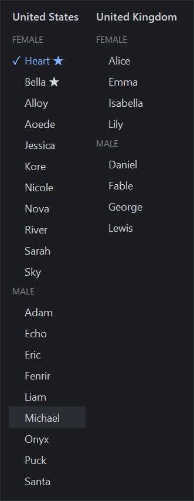
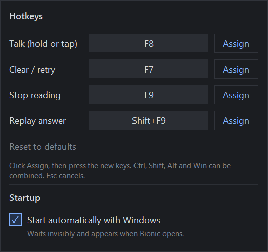

# Bionic Voice Overlay

Talk to **[Bionic](https://lmstudio.ai)** (LM Studio's local AI app) with a hotkey, and hear its
answers in a natural voice. A slim panel docks to the side of Bionic's window. Everything runs
on your own PC: no cloud, no accounts, no telemetry.

<p>
  
  &nbsp;
  
  &nbsp;
  
</p>

## Features

- **Hold to talk, or talk hands-free.** Hold `F8` while you speak and let go to send, or tap `F8` and it sends by itself after a few seconds of silence.
- **Uses Bionic's own speech-to-text.** The overlay presses Bionic's mic and Send buttons for you; nothing is transcribed elsewhere.
- **Reads every answer aloud** with [Kokoro-82M](https://huggingface.co/hexgrad/Kokoro-82M), a small, natural-sounding local voice model. Only the final answer is read, not the model's reasoning; code blocks are skipped.
- **Misspoke? Clear and retry** (`F7`) before anything is sent.
- **28 US and UK voices** to pick from (54 in the pack), adjustable speed, and room for extra voice files.
- **Docks to Bionic's window**: follows it, hides when Bionic is minimized or closed.
- **Hotkeys you can change** from the panel, and an option to **start automatically** with Windows.
- Works with Bionic in **any of its 11 interface languages**.

## Install (Windows 10/11, no Python needed)

1. Download **`BionicVoice-<version>-windows-x64.zip`** from the
   [latest release](https://github.com/Unseen-Media/bionic-voice-overlay/releases/latest) (about 490 MB, mostly the voice model).
2. Unzip it somewhere permanent, e.g. `Documents\BionicVoice`. Keep the files together:
   `BionicVoice.exe` needs the `_internal` and `models` folders next to it.
3. Double-click **`BionicVoice.exe`**. The app isn't code-signed, so Windows may show
   *"Windows protected your PC"*: click **More info → Run anyway**.

### Set up Bionic once

4. In Bionic's chat box, pick a model (**Choose a model**).
5. Click the **microphone** button in Bionic's chat box and set up voice transcription
   (pick a speech model). Bionic does the speech-to-text itself.

### Start it together with Bionic

6. Click **Setup** on the panel and tick **Start automatically with Windows**.
   Bionic Voice then starts when you sign in, stays invisible (no voice model loaded,
   hotkeys inactive) and appears next to Bionic whenever you open it.

## Using it

| Hotkey     | What it does |
|------------|--------------|
| Hold `F8`  | Talk while holding; let go to send |
| Tap `F8`   | Talk hands-free: it sends after a few seconds of silence, or when you tap again |
| `F7`       | Clear and retry: stop listening **without sending** and empty Bionic's chat box |
| `F9`       | Stop reading aloud |
| `Shift+F9` | Read the last answer again |

A press counts as a *hold* after 0.4 s. `F7` also works in the moment after you stop talking,
while Bionic is still finishing the text, so a message you regret is never sent.

**The panel**, top to bottom (hover over any button for a description):

| Button | |
|---|---|
| Status dot | Grey ready · red listening (counts down *Send in 3, 2, 1*) · amber working · blue thinking · green speaking. Drag it to slide the panel along the window edge. |
| **Talk** | Hold or tap, same as `F8` |
| **Clear** | Clear and retry, same as `F7` |
| **Stop** / **Replay** | Stop reading aloud / read the last answer again |
| **Auto** | Press Send automatically after transcribing. Off: the text waits in Bionic's chat box. |
| **Auto-stop** (clock) | Click: on/off. Right-click or scroll: silence time (2–10 s) for hands-free talking. Never cuts you off while you hold the key. |
| **Read** | Read every finished answer aloud, including messages you typed yourself |
| **Voice** | Pick from every US and UK voice (★ = top-rated); each choice plays a sample. Scroll to step through them. |
| **Speed** | Speaking speed (click: faster, right-click: slower) |
| **Setup** | Change the hotkeys; start automatically with Windows |
| **Side** | Dock on the left or right of Bionic |
| **Quit** | Close Bionic Voice |

### Changing hotkeys

**Setup → Assign** next to an action, then press the new combination: Ctrl / Shift / Alt / Win
plus any key (e.g. `Ctrl+Shift+F8`, `Alt+K`). Esc cancels; **Reset to defaults** restores the
keys above. Keys already in use are refused, and so are plain letters, numbers or Space without
Ctrl/Alt (they would also fire while you type).

### Settings file

Everything on the panel is saved in `config.json` next to the app (created on first run). A few
extra options are only there; restart Bionic Voice after editing:

| Setting | Default | |
|---|---|---|
| `hold_seconds` | `0.4` | How long a press must last to count as hold-to-talk |
| `vad_threshold` | `0.5` | Speech detection sensitivity (0–1). Raise it if background noise stops auto-stop from triggering. |
| `input_device` | `null` | Microphone for silence detection; `null` = Windows default (what Bionic uses) |
| `output_device` | `null` | Speakers/headphones for the voice; `null` = Windows default |
| `read_mode` | `"final"` | `"final"`: read the last message of the answer; `"all"`: every message of the turn |
| `bionic_home` | `~/.lmstudio/apps/bionic` | Where Bionic keeps its chats |

### Extra voices

All 54 official Kokoro voices are built in. To add others (community voices or blends), drop their
`.pt` files (the format Kokoro generators use) or `.npy` files into the `voices` folder and restart;
they appear under **Custom** in the voice picker. Names like `af_myvoice` / `bm_myvoice` set the accent
(`a` American, `b` British). Voice files are read as plain data and never executed: a `.pt` file
containing anything other than a voice tensor is refused.

## Troubleshooting

| Message / problem | Fix |
|---|---|
| *Bionic's chat box isn't on screen* | Open a chat in Bionic (not Settings), then try again. |
| *Voice transcription isn't set up in Bionic yet* | Click the mic button in Bionic's chat box once and pick a speech model. |
| *Bionic doesn't have microphone access* | Windows Settings → Privacy & security → Microphone: allow desktop apps. |
| Hands-free talking doesn't stop by itself | Background noise counts as speech: raise `vad_threshold`, or tap `F8` to send. |
| The panel doesn't appear | It only shows while a Bionic window is open. Check `overlay.log` next to the app. |
| Antivirus warning | The app listens for its hotkeys system-wide, which some scanners flag. That is all it does with the keyboard; the full source is here and in the zip's `source` folder. |
| Hotkeys don't work in one app | Windows doesn't deliver hotkeys to apps running as administrator unless Bionic Voice also runs as administrator. |

Everything that happens is logged to `overlay.log` next to the app.

## Uninstall

Untick **Setup → Start automatically with Windows**, click **Quit**, then delete the folder.

## Run from source

Requires Windows and Python 3.11+.

```powershell
git clone https://github.com/Unseen-Media/bionic-voice-overlay
cd bionic-voice-overlay
pip install -r requirements.txt
python download_models.py      # Kokoro voice (~350 MB) + Silero VAD (2 MB) into ./models
start.bat                      # or: python main.py
```

`python main.py --selftest` checks the voice, silence detection and Bionic hookup without opening
any window and writes the result to `selftest.txt`.

### Build the Windows package

```powershell
pip install pyinstaller
python build.py
```

This creates `dist/BionicVoice/` (the exe, models, notices and a copy of the source) and
`dist/BionicVoice-<version>-windows-x64.zip`.

## How it works

- **Pressing Bionic's buttons:** through Windows UI Automation (the accessibility interface), so
  the mouse and keyboard are never touched and Bionic doesn't need focus. Buttons are found by their
  labels, which are read from Bionic's own translation tables at startup, so every UI language works.
- **Reading the answers:** from Bionic's chat database
  (`~/.lmstudio/apps/bionic/projects/*/.internal/ng-sessions.sqlite`), opened **read-only**. A
  finished turn ends with an `assistantTurnEnd` marker; the answer is the assistant's text parts
  after your prompt.
- **Speaking:** Kokoro-82M via [kokoro-onnx](https://github.com/thewh1teagle/kokoro-onnx), on the
  CPU, sentence by sentence so speech starts right away.
- **Auto-stop:** [Silero VAD](https://github.com/snakers4/silero-vad) listens to the microphone
  while you talk hands-free, only to measure whether someone is speaking.
- **Docking:** the panel follows Bionic's window, and stays visible whenever Bionic is.

### Privacy

Nothing leaves your computer. Bionic Voice reads Bionic's chat database (read-only) only to get the
text of each new answer, keeps nothing, and uses the microphone only while you're talking
hands-free, to detect silence; that audio is never recorded or stored.

### Compatibility

Tested with Bionic 1.1.8 on Windows 11. The overlay relies on Bionic internals (accessibility
labels and the chat database layout); a future Bionic update could change them. If something
stops working after an update, please open an issue with your `overlay.log`.

## License

[GPL-3.0](LICENSE). The release package bundles third-party components listed in
[THIRD-PARTY-NOTICES.txt](package/THIRD-PARTY-NOTICES.txt) (including espeak-ng and phonemizer,
which are GPL-3.0).

Bionic and LM Studio are products of Element Labs. This project is independent and is not made by,
endorsed by, or affiliated with LM Studio.
